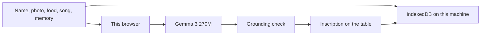

# Veladora

A private ofrenda for Día de los Muertos. You place a name, a photo, a food, a song, and one memory on a table. [Gemma 3 270M](https://huggingface.co/onnx-community/gemma-3-270m-it-ONNX), an open-weight model, writes the inscription in your browser. Any sentence that is not grounded in what you placed is struck through and labeled **Not on the table**.

Photos, words, and the finished inscription stay in this browser. The weights download once from Hugging Face. After that, lighting another candle does not need a network connection, and nothing you type is sent to a model host.

## Run it

```bash
npm install
npm run dev
```

Open the local URL. Choose **Use Rosa’s table** if you want a filled example, then **Light the candle**. The first visit downloads about 260 MB on a machine with WebGPU, or more if it has to run on the processor. The candle shows that progress.

```bash
npm test
npm run build
```

`npm run preview` serves the production build with the same isolation headers as the dev server.

## How the open model is the product



Gemma is loaded with [Transformers.js](https://huggingface.co/docs/transformers.js) inside a web worker. WebGPU uses the `q4f16` weights. If that cannot start, the worker tries the 4-bit and then the 8-bit build on the processor. The 4-bit processor build needs ONNX Runtime’s plain WebAssembly file, because the default build has no CPU kernel for Gemma’s block-quantized embedding.

The grounding check is local and deterministic. It keeps a sentence when its details are already in your notes, and strikes a sentence that adds a year, a food, a person, or an event you did not write. A hosted chat model will invent a life for someone who cannot correct it. This one can be refused, on your machine, with the refusal left visible.

The model weights are Google’s Gemma model under the [Gemma Terms of Use](https://ai.google.dev/gemma/terms). This repository does not redistribute them.

## What stays here

- The photo and the altar are stored in IndexedDB.
- The form draft is stored in `sessionStorage` so a refresh does not clear the table.
- Print produces a card with the photo, the name, and the sentences the check kept.
